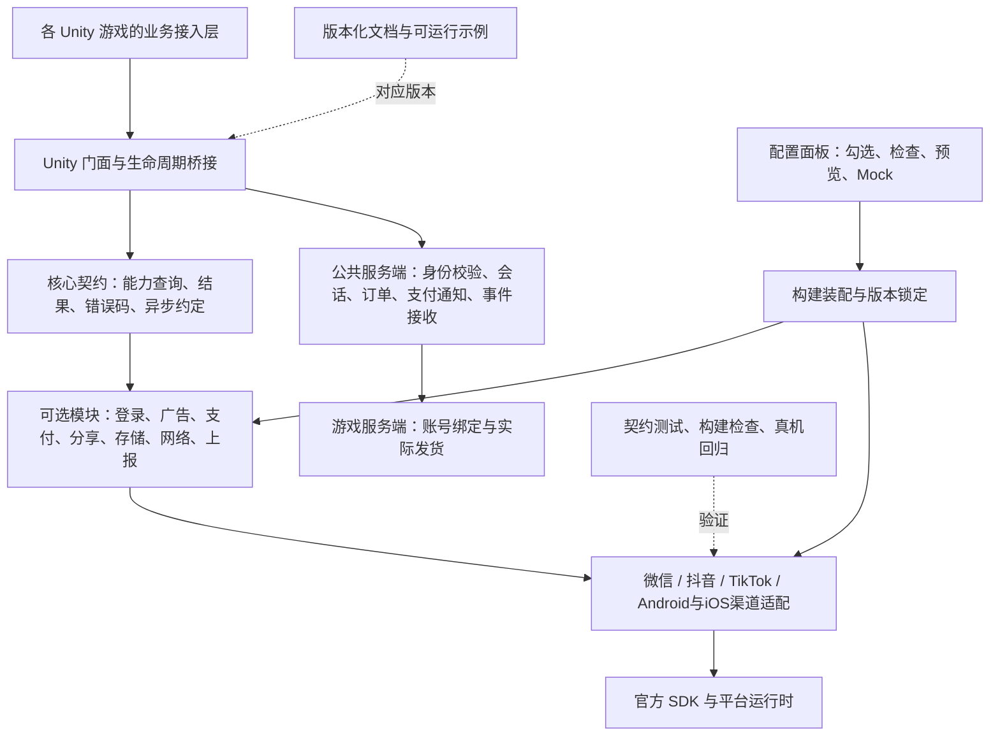
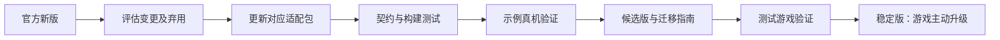

# 整体架构（设计草案 v0.1）

## 目标与边界

新游戏安装核心包和所需适配包，填写平台配置，绑定账号、角色、奖励等业务回调，即可复用接入能力。微信是语义基准，不是公共包运行时依赖；不承诺其他平台具备全部微信能力。Android/iOS 是操作系统，商店、发行商、广告供应商需要分别适配。



## 包和仓库布局（计划）

```text
Packages/
  com.erdon.unitysdk.core/          核心接口、结果与能力模型
  com.erdon.unitysdk.unity/         Unity 生命周期与主线程桥接
  com.erdon.unitysdk.editor/        配置窗口与构建检查
  com.erdon.unitysdk.module.*/      各可选能力模块
  com.erdon.unitysdk.platform.*/    平台适配包
Samples~/                         无游戏业务依赖的示例
server/                           公共服务端组件（实现语言另行确定）
compatibility/                    已验证版本组合与验证记录
docs/                             接入、接口、排错、升级文档
```

每个包独立声明依赖；单仓库迭代，通过标签和包路径引用固定版本。平台包依赖核心契约，不反向引用游戏、UI框架或热更新框架。平台公共桥接和各能力实现分开装配，避免选登录时隐式引入全部业务模块。第三方 SDK 是否可随仓库分发按授权处理，不提交游戏密钥或私有授权包。

## 配置面板与模块装配

- 按游戏、目标平台、测试/生产环境保存配置；配置包含模块开关和非敏感平台参数。
- 预览启用能力、依赖关系、所需官方包版本、缺失配置及平台限制。
- 构建时关闭模块：不注册、不初始化、不生成对应入口；可拆分依赖不进入构建。官方整包无法拆分时明确显示保留依赖。
- 运行时开关只能停用已包含模块，不能启用构建时未包含的模块。
- 关闭的模块返回 `MODULE.DISABLED`，平台缺失能力返回 `CAPABILITY.NOT_SUPPORTED`。
- Mock 面板模拟成功、取消、超时、限流等结果；生产构建禁止选择 Mock 适配器。Mock 与真机结果明确分开。
- 密钥、支付验签材料放在服务端；客户端不以隐藏配置代替安全边界。

## 接口一致性

统一参数含义、结果、错误、回调顺序、重复调用和生命周期行为。适配器负责参数转换及错误映射。差异通过能力查询和平台扩展入口表达，不伪造成功。

核心契约避免 Unity 类型；Unity 层负责主线程派发。异步操作需定义超时、取消与回调去重；取消本地等待不等于撤销已发起支付。广告关闭不等于完成观看，分享回调不等于送达。平台登录凭证不直接当作游戏会话。

具体 C# 异步类型、最低 Unity 版本与编译后端在首个实现迭代确定并锁定；不得无意引入某个游戏使用的第三方异步库。

## 服务端

按游戏、平台应用和环境隔离配置、凭据、身份、订单与事件。服务端校验平台凭证并签发游戏会话；游戏决定是否绑定已有账号。支付包括创建订单、拉起支付、验签通知、查单与对账；付款确认和游戏发货分别记录，以幂等通知连接游戏服务端。客户端成功回调与遥测事件均不作为发货依据。

## 官方 SDK 升级



分别记录核心版本、模块/适配包版本、官方依赖版本、Unity/工具链版本、运行时最低要求与验证范围。核心采用语义版本：破坏兼容的变更升级主版本；新增兼容能力升级次版本；修复升级补丁版本。

依赖不自动追最新。构建保存精确版本清单和配置摘要，支持回退本地依赖与配置；平台服务端或玩家运行时的强制变化不能靠回退解决。运行时仍需能力检测。兼容矩阵区分已验证、未验证和不兼容，写明验证日期、设备及模块，未验证不等于支持。

升级优先由适配层吸收变化；官方删除能力、改变授权或支付语义时必须公开迁移影响。新增未知平台错误保留原始信息并映射到保底错误，不误判为成功。

## 文档与示例

每个公开接口包含用途、平台范围、前置模块、参数、结果、错误码、回调线程/顺序、生命周期、取消与重试规则、成功/失败/取消示例、平台差异和真机验证步骤。

每个模块有最小可运行示例，另提供登录到游戏会话、广告到游戏领奖、订单到服务端发货的端到端示例。面板链接对应版本文档；示例参与编译检查，Mock 测试不替代真机验收。
